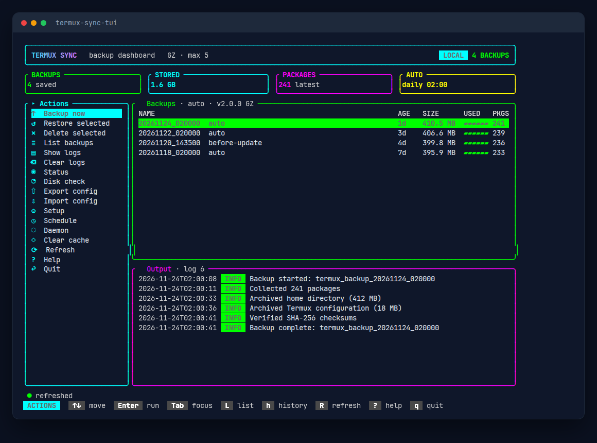
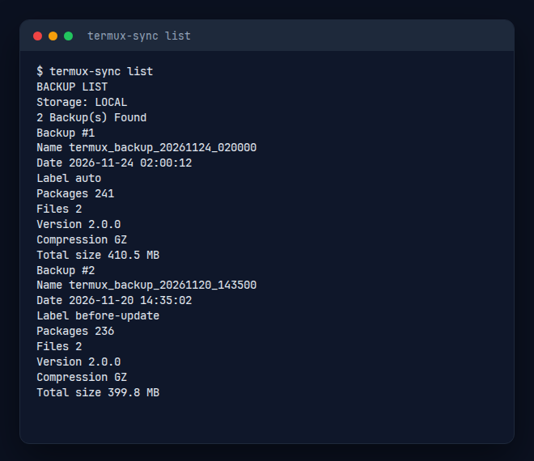

<p align="center">
  

[](https://www.rust-lang.org/)
[](LICENSE)
[](https://termux.dev)
[](#backup-layout)
[](CONTRIBUTING.md)
</p>

# termux-sync

Back up and restore a Termux environment across devices. termux-sync saves the
installed packages, home directory, and Termux configuration as one portable backup.
Backups can stay on the device, go to Google Drive through rclone, or live in a private
GitHub repository as GitHub Releases.

This repository is the pure Rust implementation of
[termux-sync](https://github.com/djunekz/termux-sync), the original Python project by
[djunekz](https://github.com/djunekz). The command line, configuration file, manifest,
and backup layout are unchanged, so backups move between both implementations in
either direction.

---

## Screenshots

The TUI shows backups, storage totals, schedules, and the current log:

<p align="center">
  
</p>

The CLI lists each backup with its date, label, package count, version, compression,
and size:

<p align="center">
  
</p>

Both screenshots come from the release binaries and use demo data.

---

## Features

| Feature | Description |
|---|---|
| Full backup | Packages, `$HOME`, and `$PREFIX/etc` in one archive set |
| Verified restore | SHA-256 check before extraction, then package reinstallation |
| Three backends | Local disk, Google Drive, or a private GitHub repository |
| Retention | Keep the newest `max_backups` copies |
| Auto-backup | Daily schedule with a Termux:Boot startup script |
| TUI | Ratatui dashboard with live progress and typed restore confirmation |
| Maintenance | Disk check, cache cleaner, log viewer, and log reset |
| Portable config | Export and import settings without exposing tokens |

The library crate is an internal implementation detail shared by the two binaries.
It is public because Cargo requires it, but no API stability is promised.

---

## Origin and compatibility

termux-sync began as a Python project by
[djunekz](https://github.com/djunekz/termux-sync). This repository rewrites it in
Rust, with the same behavior and on-disk formats.

- `manifest.json` keeps the same keys and SHA-256 checksums.
- Archives keep the same `home.tar.*` and `usr_etc.tar.*` names and layout.
- The configuration stays at `~/.config/termux-sync/config.json` with the same keys.

Backups created by the Python release restore here, and backups created here restore
with the Python release. No migration step is required.

---

## Requirements

```text
Rust 1.100 or newer (pkg install rust)
dpkg (included in Termux)
```

Optional:

- `rclone` for Google Drive (`pkg install rclone`)
- `git` only to clone this repository (`pkg install git`)
- `Termux:Boot` for auto-backup at device start (install from F-Droid)

The installed binaries do not need Python or an external `tar` command.

---

## Installation

```bash
pkg install rust git
git clone https://github.com/GeneralKaos666/termux-sync-rust ~/termux-sync
cd ~/termux-sync
bash install.sh
```

`install.sh` builds `termux-sync` and `termux-sync-tui` and installs both into
`$PREFIX/bin`.

After the first crates.io release, you can install both commands with:

```bash
cargo install termux-sync
```

### Prebuilt Termux packages

Pick the architecture from `uname -m`: `aarch64` or `arm`. Download
`termux-sync_2.0.0_<arch>.deb`, `termux-sync-signing-key.asc`, `SHA256SUMS`, and
`SHA256SUMS.asc` from
the `v2.0.0` GitHub Release. The signing key fingerprint is
`1DED 0840 4574 B867 B058 A7BB 476F C230 ECBB FDF0`
(`476FC230ECBBFDF0`).

```bash
gpg --import termux-sync-signing-key.asc
gpg --verify SHA256SUMS.asc SHA256SUMS
sha256sum -c SHA256SUMS
gpg --verify termux-sync_2.0.0_aarch64.deb.asc termux-sync_2.0.0_aarch64.deb
pkg install ./termux-sync_2.0.0_aarch64.deb
```

The package installs both commands and depends on `dpkg`.

### Apt repository

The package is also available from the personal apt repository:

```bash
mkdir -p "$PREFIX/etc/apt/keyrings"
curl -fsSL https://generalkaos666.github.io/termux-apt-repo/key.gpg \
     -o "$PREFIX/etc/apt/keyrings/termux-apt-repo.gpg"
echo "deb [signed-by=$PREFIX/etc/apt/keyrings/termux-apt-repo.gpg] https://generalkaos666.github.io/termux-apt-repo stable main" \
     > "$PREFIX/etc/apt/sources.list.d/termux-apt-repo.list"
apt update
apt install termux-sync
```

See [GeneralKaos666/termux-apt-repo](https://github.com/GeneralKaos666/termux-apt-repo)
for the repository details.

To keep an existing Python command as a rollback, run `bash cutover.sh`. The old
command is saved as `termux-sync-python`.

---

## Quick start

```bash
termux-sync setup
termux-sync backup --label first-run
termux-sync list
termux-sync restore
```

`setup` chooses the storage backend, compression, and retention limit. Run it before
the first backup.

Other examples:

```bash
termux-sync backup --label "before-new-phone"
termux-sync restore --name termux_backup_20240415_143000
termux-sync delete --name termux_backup_20240415_143000 --yes
termux-sync logs --lines 100
```

---

## Storage backends

### Local

Choose option **1** in `termux-sync setup`. The default path is
`~/termux-backups`. Enter another path to use a mounted drive.

### Google Drive

```bash
pkg install rclone
rclone config
termux-sync setup
```

Create the rclone remote with the exact name `termux-sync-gdrive`, then choose option
**2**. Leave the folder ID empty for the Drive root, or enter a folder ID.

### GitHub

1. Create a private GitHub repository, for example `my-termux-backup`.
2. Open **Settings → Developer settings → Personal access tokens → Fine-grained tokens**.
3. Grant the token access to that repository with **Contents: Read and write**.
4. Run `termux-sync setup` and select option **3 (GitHub)**.
5. Enter the token, the repository as `owner/repo`, and the branch (default `main`).

Each backup becomes a GitHub Release tagged with the backup name. Archive files are
release assets, split into 200 MB parts when needed. A classic token with the `repo`
scope also works, but it grants access to every repository you own.

---

## Commands

| Command | Purpose |
|---|---|
| `backup` | Create a backup |
| `restore` | Restore a backup |
| `list` | List available backups |
| `delete` | Delete a backup |
| `setup` | Configure storage and preferences |
| `schedule` | Set the daily auto-backup |
| `daemon` | Run the scheduler used by Termux:Boot |
| `status` | Show configuration and environment |
| `logs` | Show recent log lines |
| `clear-logs` | Truncate the log file |
| `check` | Show disk usage |
| `clear-cache` | Remove cache directories |
| `export-config` | Export settings with secrets redacted |
| `import-config` | Import settings from a file |
| `tui` | Launch the terminal dashboard |
| `help` | Show help |

Every command accepts `--json-events` for machine-readable progress and `--debug` for
tracebacks. Backup takes `-l/--label`; restore and delete take `-n/--name`; logs takes
`--lines N` (default 40); delete, clear-logs, and clear-cache take `--yes`.

`check` without a path shows Termux root, `~`, and `$PREFIX`. Give a path for a folder
breakdown:

```bash
termux-sync check ~
termux-sync check $PREFIX
```

`clear-cache` checks `$PREFIX/tmp`, `~/.cache`, `~/.npm`, `~/.cargo/registry`,
`~/.cargo/git`, `~/__pycache__`, `~/.gradle/caches`, `~/.m2/repository`, and
`~/go/pkg/mod/cache`. It asks twice before deleting anything.

`export-config` writes `~/termux-sync-config-export.json` by default, replaces tokens
with `*** REDACTED ***`, and uses mode `0600`. `import-config` skips redacted values,
so stored credentials stay in place.

---

## What gets backed up

| Component | Source | Content |
|---|---|---|
| Packages | `dpkg --get-selections` | Installed package list |
| Home | `$HOME` | Dotfiles, scripts, and projects |
| Termux config | `$PREFIX/etc` | `sources.list`, `motd`, and similar files |

Shared libraries, installed binaries, and caches are not archived. Restore reinstalls
packages from the recorded list.

These paths are excluded from the home archive by default:

```text
.cache  .npm  __pycache__  node_modules  .gradle  .android  .thumbnails
DCIM  Movies  Music  .local/share/Trash  .local/lib  .java  .m2  .ivy2
go/pkg  .rustup/toolchains  .cargo/registry  .cargo/git
```

`~/.config/termux-sync` is always excluded, so the config and log stay out of the
archive. Patterns match whole path components at any depth: `.cache` matches
`~/.cache`, but not `~/notes.cache`. Wildcards are not supported.

---

## Backup layout

```text
termux-backups/
└── termux_backup_20240415_143000/
    ├── manifest.json       version, compression, checksums, packages, sources
    ├── packages.txt        plain-text package list
    ├── home.tar.gz         home directory archive
    └── usr_etc.tar.gz      Termux configuration archive
```

The extension follows the compression setting: `gz`, `bz2`, or `xz`. On GitHub, each
archive is uploaded as a release asset and split into `.partNNNN` files above 200 MB.

Restore reads `manifest.json`, verifies every SHA-256 checksum, then extracts the
archives and installs the recorded packages.

---

## Configuration

Location: `~/.config/termux-sync/config.json`

```json
{
  "storage": "github",
  "local_path": "~/termux-backups",
  "gdrive_folder_id": "",
  "github_token": "",
  "github_repo": "owner/my-termux-backup",
  "github_branch": "main",
  "compression": "gz",
  "exclude_patterns": [".cache", "node_modules"],
  "max_backups": 5,
  "encrypt": false,
  "encrypt_password": ""
}
```

| Key | Default | Notes |
|---|---|---|
| `storage` | `local` | `local`, `gdrive`, or `github` |
| `local_path` | `~/termux-backups` | Local backup directory |
| `gdrive_folder_id` | empty | Drive folder ID; empty uses the root |
| `github_token` | empty | Token with `Contents: Read and write` |
| `github_repo` | empty | Repository in `owner/repo` form |
| `github_branch` | `main` | Branch used as the release target |
| `compression` | `gz` | `gz` (fast), `bz2` (balanced), or `xz` (smallest) |
| `exclude_patterns` | list above | Paths left out of the home archive |
| `max_backups` | `5` | Copies kept before pruning |
| `encrypt` | `false` | Reserved; encryption is not implemented |
| `encrypt_password` | empty | Reserved for compatibility |

Environment variables are optional:

| Variable | Default | Purpose |
|---|---|---|
| `TERMUX_SYNC_DEBUG` | empty | Any non-empty value enables debug output |
| `PREFIX` | `/data/data/com.termux/files/usr` | Termux prefix |
| `HOME` | `/data/data/com.termux/files/home` | Backup source |
| `TMPDIR` | `/data/data/com.termux/files/usr/tmp` | Archive work directory |

---

## Auto-backup

```bash
termux-sync schedule
```

The wizard stores the schedule in `~/.config/termux-sync/cron.json` and writes
`~/.termux/boot/termux-sync-daemon.sh`. Install
[Termux:Boot](https://f-droid.org/en/packages/com.termux.boot/) from F-Droid and open
it once. The script starts `termux-sync daemon` at boot. Only one daemon runs at a
time.

---

## Move to a new device

On the old device:

```bash
termux-sync backup --label migration
```

On the new device, install termux-sync, configure the same backend, and restore:

```bash
pkg install rust git
git clone https://github.com/GeneralKaos666/termux-sync-rust ~/termux-sync
cd ~/termux-sync
bash install.sh
termux-sync setup
termux-sync restore
```

Restore verifies checksums, extracts the archives, and reinstalls packages. Python-era
backups work without conversion.

---

## Troubleshooting

| Problem | Fix |
|---|---|
| `rclone not found` | `pkg install rclone`, then `rclone config` with the remote `termux-sync-gdrive` |
| GitHub 401 or 403 | Check the token and its `Contents: Read and write` access to the repository |
| Backup too large | Add paths to `exclude_patterns` or run `termux-sync clear-cache` first |
| Restore writes the wrong path | Check the source paths in the backup's `manifest.json` |
| `termux-sync: command not found` | Re-run `bash install.sh` from the clone |
| `cargo: command not found` | Run `pkg install rust` |
| Daemon missing at boot | Install Termux:Boot from F-Droid and open it once |
| Config lost after reinstall | Run `export-config` before uninstalling, then `import-config` |

---

## TUI

The TUI shares the Rust core and ships with `termux-sync`. It streams operations
through `termux-sync --json-events`, shows live stages and logs, lists local and
remote backups, and gates restore behind a package diff and a typed confirmation.

```bash
termux-sync tui
# or
termux-sync-tui
```

It needs a termux-sync 2.0 build. Use `--ascii` or `TERMUX_SYNC_TUI_ASCII=1` when the
terminal font renders the icons badly. Keys and layout live in
[docs/tui/README.md](https://github.com/GeneralKaos666/termux-sync-rust/blob/main/docs/tui/README.md);
recovery steps live in
[docs/tui/RUNBOOK.md](https://github.com/GeneralKaos666/termux-sync-rust/blob/main/docs/tui/RUNBOOK.md).

---

## Contributing

Read [CONTRIBUTING](CONTRIBUTING.md) before opening a pull request. Use the GitHub
issue tracker for bugs and feature requests.

---

## Credits

- Original Python project: [djunekz/termux-sync](https://github.com/djunekz/termux-sync)
- Rust implementation: [GeneralKaos666/termux-sync-rust](https://github.com/GeneralKaos666/termux-sync-rust)

---

## License

MIT License. See [LICENSE](LICENSE).
