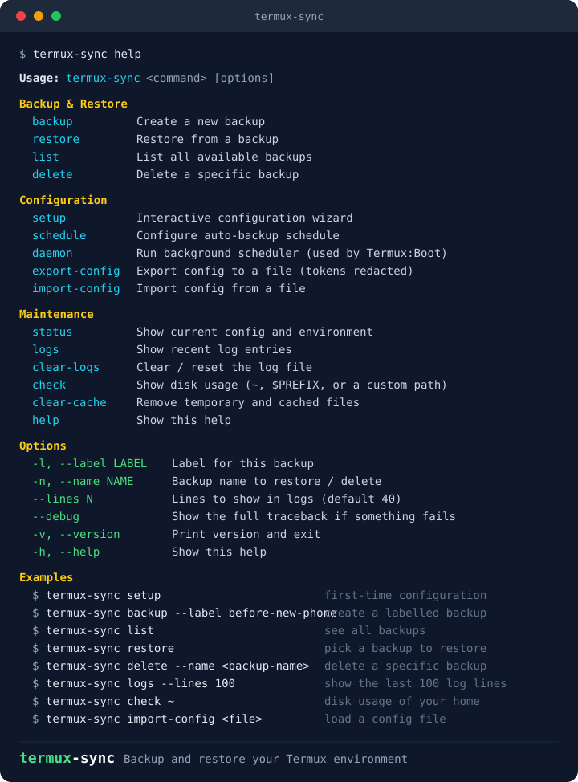

<p align="center">
  

[](https://www.rust-lang.org/)
[](LICENSE)
[](https://termux.dev)
[](https://github.com/GeneralKaos666/termux-sync-rust/releases/latest)
[](https://github.com/GeneralKaos666/termux-sync-rust/commits/main)
[](https://github.com/GeneralKaos666/termux-sync-rust/stargazers)
[](https://github.com/GeneralKaos666/termux-sync-rust/network/members)
[](https://github.com/GeneralKaos666/termux-sync-rust/issues)
[](https://github.com/GeneralKaos666/termux-sync-rust/pulls)
[](https://github.com/GeneralKaos666/termux-sync-rust)
[](https://termux.dev)
[](#setup)
[](https://ratatui.rs)
[](#backup-structure)
[](CONTRIBUTING.md)
[](https://github.com/GeneralKaos666/termux-sync-rust/commits/main)
</p>

# termux-sync

Backup and restore your entire Termux environment across devices.
termux-sync captures your installed packages, home directory, and configuration files into a portable backup that can be fully restored on any device. Backups can be stored locally, uploaded to Google Drive via rclone, or pushed to a private GitHub repository.

This is the pure Rust implementation of [termux-sync](https://github.com/djunekz/termux-sync), the original Python project by [djunekz](https://github.com/djunekz). The command line, configuration file, backup layout, and manifests are unchanged, so backups made by the original Python release restore here, and backups made here restore with it.

---

<p align="center">
  
</p>

## Features

| Feature | Description |
|---|---|
| Full backup | Packages, home directory, `/usr/etc` config, shared libraries |
| Full restore | Archive extraction and package reinstallation in one command |
| Delete backup | Remove a specific backup from any storage backend |
| Local storage | Save backups on-device or to any mounted path |
| Google Drive | Upload and retrieve via rclone |
| GitHub private repo | Push and pull using a Personal Access Token (200 MB per part) |
| Auto-backup | Built-in daily scheduler at a configurable time |
| Disk check | View storage usage for any path with per-folder breakdown |
| Cache cleaner | Selective or full cache removal with two-step confirmation |
| Log viewer | Color-coded log output with configurable line count |
| Clear logs | Truncate the log file in one command |
| Export config | Save configuration to a portable file (tokens redacted) |
| Import config | Load configuration from a previously exported file |
| Checksum verification | SHA-256 integrity check performed on every restore |
| Terminal UI | Ratatui operations cockpit in `termux-sync-tui` |
| Persistent logging | Full log written to `~/.config/termux-sync/sync.log` |

---

## Requirements

```
Rust 1.100+ (pkg install rust)
tar (included in Termux)
```

Optional dependencies depending on which storage backend you use:

- `rclone` — required for Google Drive (`pkg install rclone`)
- `git` — required for GitHub storage (`pkg install git`)
- `Termux:Boot` — required for auto-backup on device start (install from F-Droid)

The installed binaries have no Python runtime dependency.

---

## Installation

Build and install both binaries from a clone:

```bash
pkg install rust git
git clone https://github.com/GeneralKaos666/termux-sync-rust ~/termux-sync
cd ~/termux-sync
bash install.sh
```

`install.sh` delegates to `rust/install.sh`, which builds `termux-sync` and
`termux-sync-tui` in release mode and installs them into `$PREFIX/bin`.

To keep an existing Python command available as a rollback, run:

```bash
bash rust/cutover.sh
```

The old command is saved as `termux-sync-python` before the Rust binary replaces it.

---

## Compatibility with other termux-sync builds

Backups are portable across implementations:

- `manifest.json` keeps the same keys (`name`, `files` with `archive` and
  `checksum`, `packages`, `source`) and the same SHA-256 checksums.
- Archives keep the same names (`home.tar.gz`, `usr_etc.tar.gz`) and layout.
- The configuration file stays at `~/.config/termux-sync/config.json` with the same keys.

Any backup produced by the original Python termux-sync or another termux-sync
build can be listed, verified, and restored by this one. Backups created here
can also be restored by those builds. No migration step is required.

---

## Setup

Run the interactive setup wizard before using termux-sync for the first time:

```bash
termux-sync setup
```

The wizard will ask you to choose a storage backend and provide any required credentials. You can also optionally customise the exclude patterns during setup.

### GitHub private repo (recommended)

1. Create a private GitHub repository, for example `my-termux-backup`
2. Go to **Settings → Developer settings → Personal access tokens → Fine-grained tokens**
3. Grant the token access to that one repository only, with **Contents: Read and write**
4. Run `termux-sync setup` and select option **3 (GitHub)**
5. Enter your token and repository name in the format `username/repo`

A fine-grained token scoped to the backup repository is preferred. A classic token with the `repo` scope also works, but it grants read and write access to every repository you own.

---

## Command Reference

### Backup

```bash
termux-sync backup
termux-sync backup --label "before-new-phone"
```

### Restore

```bash
termux-sync restore                                          # interactive picker
termux-sync restore --name termux_backup_20240415_143000    # restore specific backup
```

### List all backups

```bash
termux-sync list
```

Displays name, date, label, package count, compression, version, and total size for each backup.

### Delete a backup

```bash
termux-sync delete                                          # interactive picker
termux-sync delete --name termux_backup_20240415_143000     # delete specific backup
```

Requires confirmation before deletion. Works with local, Google Drive, and GitHub storage.

### Setup wizard

```bash
termux-sync setup
```

### Schedule daily auto-backup

```bash
termux-sync schedule
```

### Check configuration and environment

```bash
termux-sync status
```

Shows storage backend, compression, schedule, app version, available tools, and (for local storage) the number of stored backups.

### View log entries

```bash
termux-sync logs
termux-sync logs --lines 100
```

### Clear log file

```bash
termux-sync clear-logs
```

Truncates `~/.config/termux-sync/sync.log` after a single confirmation prompt.

### Check disk usage

```bash
termux-sync check                              # overview: Termux root, ~, $PREFIX
termux-sync check ~                            # home directory + subfolder breakdown
termux-sync check $PREFIX                      # $PREFIX + subfolder breakdown
termux-sync check /data/data/com.termux/files  # custom path
```

### Clear cache

```bash
termux-sync clear-cache
```

Lists all detected cache directories with sizes. You can clear all of them or select specific entries by number. Two confirmation prompts are shown before anything is deleted.

Targets: `$PREFIX/tmp`, `~/.cache`, `~/.npm`, `~/.cargo/registry`, `~/.cargo/git`, `~/__pycache__`, `~/.gradle/caches`, `~/.m2/repository`, `~/go/pkg/mod/cache`

### Export configuration

```bash
termux-sync export-config
termux-sync export-config ~/my-backup-config.json
```

Saves the current configuration to a JSON file. `github_token` and `encrypt_password` are automatically redacted before writing.

### Import configuration

```bash
termux-sync import-config ~/my-backup-config.json
```

Loads configuration from a previously exported file. REDACTED placeholder values are skipped so existing credentials are never overwritten.

### Background daemon

```bash
termux-sync daemon &
```

Run as a background process — triggered automatically by the Termux:Boot script written by `termux-sync schedule`.

---

## Auto-Backup

Configure a daily automatic backup:

```bash
termux-sync schedule
```

To run automatically when your device boots, install [Termux:Boot](https://f-droid.org/en/packages/com.termux.boot/) from F-Droid. The schedule wizard writes the required boot script automatically:

```bash
cat ~/.termux/boot/termux-sync-daemon.sh   # view generated boot script
termux-sync daemon &                        # or start the daemon manually
```

---

## What Gets Backed Up

| Component | Path | Description |
|---|---|---|
| Package list | `dpkg --get-selections` | All installed packages |
| Home directory | `~` | Dotfiles, scripts, projects |
| Termux config | `$PREFIX/etc` | sources.list, motd, and other config files |
| Shared libraries | `$PREFIX/lib` | Libraries installed by Termux packages |

The following paths are excluded from the home directory backup by default:

`.cache`, `.npm`, `__pycache__`, `node_modules`, `.gradle`, `.android`, `.thumbnails`, `DCIM`, `Movies`, `Music`, `.local/share/Trash`, `.local/lib`, `.java`, `.m2`, `.ivy2`, `go/pkg`, `.rustup/toolchains`, `.cargo/registry`, `.cargo/git`

You can customise exclusions in `~/.config/termux-sync/config.json` or interactively during `termux-sync setup`.

---

## Configuration File

Location: `~/.config/termux-sync/config.json`

```json
{
  "storage": "github",
  "local_path": "~/termux-backups",
  "gdrive_folder_id": "",
  "github_token": "ghp_...",
  "github_repo": "username/my-termux-backup",
  "github_branch": "main",
  "compression": "gz",
  "exclude_patterns": [
    ".cache", ".npm", "__pycache__", "node_modules", ".gradle",
    ".android", ".thumbnails", "DCIM", "Movies", "Music",
    ".local/share/Trash", ".local/lib", ".java",
    ".m2", ".ivy2", "go/pkg", ".rustup/toolchains",
    ".cargo/registry", ".cargo/git"
  ],
  "max_backups": 5,
  "encrypt": false,
  "encrypt_password": ""
}
```

| Key | Default | Description |
|---|---|---|
| `storage` | `local` | Storage backend: `local`, `gdrive`, or `github` |
| `local_path` | `~/termux-backups` | Path for local backups |
| `gdrive_folder_id` | *(empty)* | Google Drive folder ID (leave empty for root) |
| `github_token` | *(empty)* | GitHub Personal Access Token with `Contents: Read and write` on the backup repository |
| `github_repo` | *(empty)* | Repository in `owner/repo` format |
| `github_branch` | `main` | Branch to push backups to |
| `compression` | `gz` | Compression: `gz` (fast), `bz2` (balanced), `xz` (best) |
| `exclude_patterns` | *(list)* | Paths excluded from home directory archive |

Patterns are literal paths matched on whole path components, at any depth: `.cache` excludes `~/.cache` but not `~/notes.cache`. There is no wildcard support, so `*.log` matches nothing. A leading `./` is ignored.
| `max_backups` | `5` | Maximum number of backups to keep before pruning |
| `encrypt` | `false` | Enable archive encryption (planned feature) |

---

## Environment Variables

A reference file is provided at [`.env.example`](.env.example). All variables are optional; Termux sets sensible defaults.

| Variable | Default | Description |
|---|---|---|
| `TERMUX_SYNC_DEBUG` | *(empty)* | Set to any non-empty value to enable debug output |
| `PREFIX` | `/data/data/com.termux/files/usr` | Termux installation prefix |
| `HOME` | `/data/data/com.termux/files/home` | Home directory used as the backup source |
| `TMPDIR` | `/data/data/com.termux/files/usr/tmp` | Temporary directory used while building and restoring archives |

---

## Backup Structure

Each backup is a directory containing:

```
backups/
└── termux_backup_20240415_143000/
    ├── manifest.json       metadata, checksums, package list, source paths, version
    ├── packages.txt        plain-text package list for reference
    ├── home.tar.gz         home directory archive
    └── usr_etc.tar.gz      Termux config archive (/usr/etc)
```

`manifest.json` records the termux-sync version, compression type, per-archive SHA-256 checksums, and source paths. The restore command reads this file to verify integrity before extracting anything.

---

## Migrating to a New Device

**On the old device** — create a labeled backup:

```bash
termux-sync backup --label "migration"
```

**On the new device** — install termux-sync and restore:

```bash
pkg install rust git
git clone https://github.com/GeneralKaos666/termux-sync-rust ~/termux-sync
cd ~/termux-sync
bash install.sh

# Configure with the same credentials as the old device
termux-sync setup

# Restore the latest backup
termux-sync restore
```

The restore process verifies checksums, extracts the archives, and reinstalls all packages automatically. Backups from the original Python termux-sync work here without any conversion.

---

## Troubleshooting

| Problem | Solution |
|---|---|
| `rclone not found` | Run `pkg install rclone` then `rclone config` to authenticate |
| GitHub 401 error | Check that your token has the `repo` scope and has not expired |
| Archive too large | Add paths to `exclude_patterns` in `config.json`, or use `clear-cache` first |
| Restore overwrites wrong path | Check the `source` field in the backup's `manifest.json` |
| `termux-sync: command not found` | Re-run `bash install.sh` from the clone |
| `cargo: command not found` | Run `pkg install rust` |
| Daemon does not start on boot | Verify Termux:Boot is installed from F-Droid and opened at least once |
| GitHub upload fails on large backup | Add paths to `exclude_patterns` to reduce backup size |
| Cache not cleared | Run `termux-sync clear-cache` and confirm both prompts |
| Config lost after reinstall | Use `export-config` before uninstalling; `import-config` after reinstalling |
| Old backups not pruned on GDrive | Fixed in v1.2.0 — update to the current build |

---

## Project Structure

```
termux-sync-rust/
├── rust/
│   ├── app/                termux-sync CLI
│   ├── termux-sync-core/   shared core library
│   ├── app-cases/          recorded CLI behavior cases (trycmd)
│   ├── fixtures/           fixture homes, prefixes and tool stubs
│   ├── install.sh          native release build and install
│   └── cutover.sh          interactive switch from an installed Python command
├── tui/                    Ratatui operations TUI
├── assets/                 README logo and command menu
├── install.sh              delegates to rust/install.sh
├── CHANGELOG.md            Version history
├── FAQ.md                  Frequently asked questions
└── README.md               This file
```

---

## Optional Rust TUI

The `tui/` directory contains an optional Ratatui dashboard and operations
cockpit. It shares the Rust core and is installed by `rust/install.sh`.

It streams backup and restore through `termux-sync --json-events`, shows live
stages and logs, verifies backups, lists remote backups, and gates restore
behind a package diff and typed confirmation. It also keeps a local operation
history, filters backups, prompts for labels and supports ASCII icons.

Requirements:

- Rust 1.100 or newer (`pkg install rust` on Termux)
- A `termux-sync` 2.0 build

Run it from the CLI:

```bash
termux-sync tui
```

Or run the standalone alias:

```bash
termux-sync-tui
```

Install both with `bash install.sh`.
Use `--ascii` or `TERMUX_SYNC_TUI_ASCII=1` for terminals whose font renders
the default icons badly.

If the installed `termux-sync` is too old for events, backup and restore
refuse with a clear message; `L` falls back to captured text output. See [tui/README.md](tui/README.md)
for keys, cancellation rules, and layout behavior. Recovery steps live in
[tui/RUNBOOK.md](tui/RUNBOOK.md).

The TUI has its own workflow in `.github/workflows/tui.yml`. The workflow also cross-checks Android targets with the NDK; prebuilt
release binaries are a later distribution task.

---

## Contributing

Contributions are welcome. Please read [CONTRIBUTING](CONTRIBUTING.md) before opening a pull request.

For bug reports and feature requests, use the GitHub issue tracker and follow the provided templates.

---

## Credits

- Original Python implementation: [djunekz/termux-sync](https://github.com/djunekz/termux-sync)
- Rust rewrite: [GeneralKaos666/termux-sync-rust](https://github.com/GeneralKaos666/termux-sync-rust)

---

## License

MIT License. See [LICENSE](LICENSE) for the full text.
